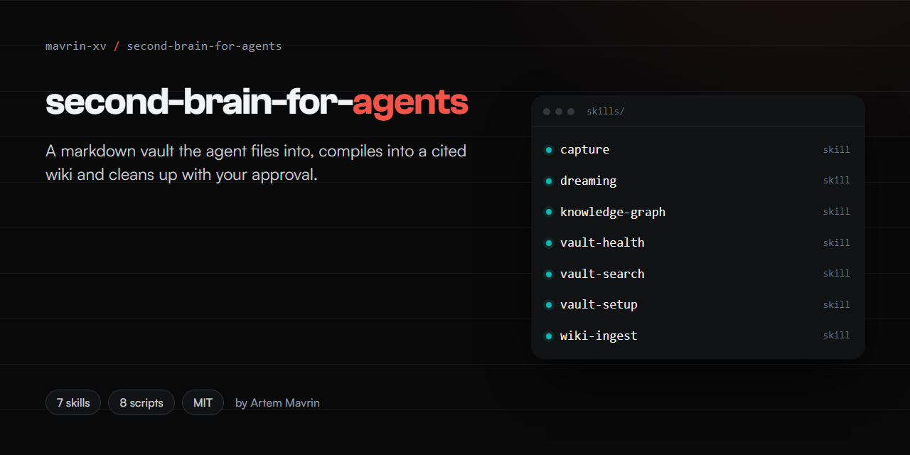

# second-brain-for-agents

**A markdown vault your AI agent keeps for you: it files what you send, compiles sources into a cited wiki, searches before it answers, and proposes a nightly cleanup that you approve or kill.**

Notes pile up faster than anyone reads them. Six months in, the "second brain" is a warehouse: duplicate pages, links to nothing, sources nobody summarised, and an agent that answers from memory instead of from your notes.

[](LICENSE)


```bash
git clone https://github.com/mavrin-xv/second-brain-for-agents && cd second-brain-for-agents
./install.sh                 # or: ./install.sh --project
```

<!-- install-notes:start -->
Other ways in: as a Claude Code plugin, run `/plugin marketplace add mavrin-xv/second-brain-for-agents` and then `/plugin install second-brain-for-agents@second-brain-for-agents`. For Codex or another agent that reads `SKILL.md`, copy the folders under `skills/` into its skills directory. On Windows, run `install.sh` from Git Bash or WSL and type `py -3` where these docs say `python3`.
<!-- install-notes:end -->

Then tell your agent: `set up a vault in ~/notes/vault` and `save this: https://example.com/some-article`.

---

## What it solves

| Pain | What the pack does |
|---|---|
| "Where do I put this?" every time | One routing table in `SCHEMA.md`; the agent files thoughts, todos, ideas, decisions and links into the right folder with frontmatter |
| Saved links never get read | `capture` stores the page as markdown in `raw/`; `wiki-ingest` compiles it into a source page plus the concept and entity pages it touches, every claim cited |
| The agent answers from its training data, not your notes | `vault-search` runs before answering or writing: qmd if installed, a built-in BM25 ranker if not |
| Twin pages and links to nothing | `new_note.py` refuses to create a concept or entity that already exists; `vault-health` finds broken links, duplicates, orphans |
| No idea how the notes connect | `knowledge-graph` writes `GRAPH.md` with clusters, most-linked pages, orphans and broken links |
| An agent that rewrites its own memory unsupervised | `dreaming` only writes a proposal file at night. You approve or kill each item in the morning; killed items never come back |
| Ideas sit at "new" for months | Health flags stuck ideas; dreaming asks for a test-or-kill decision |

## What's inside

| Skill | What it does | Say |
|---|---|---|
| `vault-setup` | Creates or tops up the vault: folders, `SCHEMA.md` routing rules, `index.md`, `log.md`, templates | "set up a vault", "start a second brain", "fix my vault layout" |
| `capture` | Files a thought, todo, idea, decision or link verbatim, with frontmatter and a duplicate check; fetches URLs into `raw/` | "save this", "note that", "capture", "remember this link" |
| `wiki-ingest` | Compiles raw sources into cited wiki pages (Karpathy LLM wiki), plan first, contradictions kept as open questions | "ingest", "compile my sources", "process the raw folder" |
| `vault-search` | Searches the vault before answering; files good answers back into `wiki/answers/` | "what do my notes say about", "search the vault", "have I written about" |
| `knowledge-graph` | Builds the link graph, writes `GRAPH.md`, keeps "Referenced by" footers | "build the graph", "what links to", "find orphans" |
| `vault-health` | 14 checks with errors, warnings and info, a score, and fixes shown before they are applied | "check the vault", "lint my notes", "vault health" |
| `dreaming` | Nightly scan that proposes merges, new pages, rules and decisions; human approves or kills | "dream", "nightly review", "what should I merge" |

Each skill folder has a `SKILL.md`, `references/` for the long parts, and stdlib Python scripts with `--help`. `templates/nightly.sh` runs the night job. `examples/sample-vault/` is a small invented vault with planted problems to try everything on.

## Quick start

```text
You:   save this https://example.com/newsletter-teardown and compile it
Agent: (capture) raw/2026-02-10-email-teardown-of-a-pottery-newsletter.md
       (wiki-ingest) plan: 1 source page, update concepts/kiln-drop-emails,
       create entities/kiln-supply-co. Go?
You:   go
Agent: wrote wiki/sources/pottery-newsletter-teardown.md, updated 2 pages,
       index.md and log.md. 1 open question: weekly digest vs per-firing email.
```

Next morning, from the bundled sample vault (real output):

```text
$ python3 skills/dreaming/scripts/dream_digest.py status --pending
D-20261120-01  pending  merge    Kiln drop email / Kiln drop emails
D-20261120-02  pending  create   concepts/drop-scarcity
D-20261120-03  pending  promote  announce the drop time two days ahead, not the same morning
D-20261120-04  pending  decide   Beginner glaze workshop on Saturdays
D-20261120-05  pending  review   2 wiki pages waiting for review

$ python3 skills/dreaming/scripts/dream_digest.py decide D-20261120-02 kill --note "covered in kiln-drop-emails"
D-20261120-02: killed
```

Full run with every script: [examples/walkthrough.md](examples/walkthrough.md).

## How it works

```
 you ──"save this"──► capture ──► inbox/ ideas/ decisions/ daily/      (your words, verbatim)
                         │
                         └─ URL ─► raw/  (immutable source)
                                     │
                                     ▼
                               wiki-ingest ──► wiki/sources  wiki/concepts  wiki/entities
                                     │            (agent-owned, cited, reviewed: false)
                                     ▼
                               index.md + log.md

 question ──► vault-search (qmd / BM25) ──► answer ──► wiki/answers/ (if worth keeping)

 night ──► knowledge-graph ──► vault-health ──► dreaming scan ──► proposals/dream-DATE.md
 morning ─► you: approve / kill ──► agent applies approved items only ──► log.md
```

Three layers, as in the LLM wiki pattern: `raw/` is never edited, `wiki/` belongs to the agent, `SCHEMA.md` holds the rules both of you follow. More in [docs/how-it-works.md](docs/how-it-works.md).

## Configure

| Setting | Where | Default |
|---|---|---|
| Vault location | `VAULT_DIR` env var or `--vault` on every script | `./vault` |
| Protected folders (never read or linked by scripts) | `SCHEMA.md`, `protected:` line | `private` |
| Stale thresholds (inbox, raw, ideas) | `SCHEMA.md`, `stale_*_days:` lines | 7, 3, 30 |
| Backlink footer threshold | `SCHEMA.md`, `footer_threshold:` | 3 inbound links |
| Search engine | install qmd (`npm install -g @tobilu/qmd`) or nothing | built-in BM25 |
| Clean HTML extraction | install defuddle, then `fetch_source.py --defuddle` | built-in stripper |
| Candidates per night | `dream_digest.py scan --max N` | 10 |

## Honest limits

- The scripts find structure, not meaning. Duplicate detection compares titles; two pages that say the same thing under different titles need the agent's judgement step.
- The built-in fetcher does not run JavaScript. Pages behind a login or rendered by script come back short; paste the text with `--stdin`.
- The plural fold is English-only and crude (`emails` = `email`, `glass` stays `glass`).
- Footers are the only change scripts make to your pages, and only with `--footers`. Everything else is written by the agent, so its quality is the model's quality. `reviewed: false` exists so you can see what you have not checked.
- Tested on the bundled sample vault, on Windows with Git Bash and Python 3.12. Not yet run on macOS or Linux, and not on vaults with tens of thousands of pages; the graph script reads every file on each run.
- qmd setup is documented but its vector search needs a model download on first `qmd embed`.

## Credits

- Based on / inspired by Andrej Karpathy's LLM wiki note, https://gist.github.com/karpathy/442a6bf555914893e9891c11519de94f (no license stated; the raw / wiki / schema split and the ingest, query, lint operations come from here)
- Search: qmd by Tobi Lutke, https://github.com/tobi/qmd (MIT)
- Extraction: defuddle by kepano, https://github.com/kepano/defuddle (MIT); vault skill conventions from https://github.com/kepano/obsidian-skills (MIT)
- Inspired by https://github.com/Astro-Han/karpathy-llm-wiki (MIT) and https://github.com/kfchou/wiki-skills (severity tiers, showing a fix before applying it)
- Ideas only, no code: https://github.com/basicmachines-co/basic-memory (AGPL-3.0), https://github.com/thedotmack/claude-mem
- Skill format: https://github.com/anthropics/skills

## Contributing

Bug reports with a small vault that reproduces them are the most useful thing. See [CONTRIBUTING.md](CONTRIBUTING.md) and the checks in [AGENTS.md](AGENTS.md).

<!-- author:start -->
## Author

Built and maintained by [Artem Mavrin](https://github.com/mavrin-xv). This repo is one of a set of agent skill packs for marketing and operations work. Each one installs on its own; the full list is in [agent-skill-packs](https://github.com/mavrin-xv/agent-skill-packs). If a pack saved you an afternoon, a star helps other people find it.
<!-- author:end -->

## License

MIT. See [LICENSE](LICENSE).
